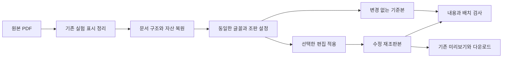
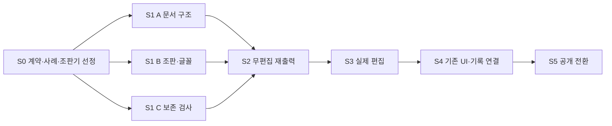

# PDF 전체 재조판 구현 계획

2026-10-27 작성. 기준 버전 `0.2.0-alpha.18`, 기준 커밋 `7b5ab1dd1e3aa582bc523b9de1fdca79456ff8c6`. 관련 WorkBite Task: T-0141. 이 문서는 구현 범위와 순서를 정하며, 새 엔진은 아직 구현하지 않았다.

## 1. 목표와 완료 기준

사용자가 논문에서 문장을 수정하면 문단·단·페이지를 다시 배치해 새 PDF를 만든다. 논문의 글꼴 체계, 단 구성, 제목, 표·그림·캡션을 이어가고 선택한 변경 이외의 정보는 보존한다. 줄바꿈과 페이지 수는 변경할 수 있다.

신규 구현은 네 가지다.

1. 문서 구조 복원: 본문 순서와 표·그림·캡션·각주 관계를 복원한다.
2. 문서 전체 재배치: 늘거나 줄어든 본문과 뒤따르는 내용을 단과 페이지 사이에서 이동한다.
3. 글꼴·문장 조판: 글자, 단어 간격, 줄바꿈과 글꼴 대체를 처리한다.
4. 내용 보존·배치 검사: 변경 반영, 미선택 내용 보존, 겹침과 잘림을 확인한다.

기존 직접 편집, undo/redo, 후보 선택, 외부 AI 응답 가져오기, PDF 미리보기, 다운로드, 실험 기록, Confluence 보관과 BLUE 전달을 재사용한다.

첫 릴리스의 완료 조건은 다음과 같다.

- 실제 36쪽 논문을 변경 없이 다시 출력해 내용과 자산을 보존한다.
- 해당 논문의 7쪽 후보를 요청된 After 그대로 적용하고 다음 제목·본문을 자연스럽게 이동한다.
- 7쪽과 26쪽 후보를 함께 적용하고 나머지 본문·표·그림·캡션을 보존한다.
- 찬물 샤워 논문의 기존 8개 변경을 같은 경로로 처리해 단·페이지를 넘는 흐름을 검증한다.
- 미리보기와 다운로드가 같은 생성 파일과 편집 버전을 사용한다.
- 원본, 변경 없는 재조판본, 수정 재조판본과 검사 결과를 구분한다.

## 2. 기존 코드의 재사용과 교체 범위

| 현재 코드 | 처리 |
| --- | --- |
| `app/dist/paper-edits.js` | 편집 세션·출처·원본 인용·undo/redo 재사용. 새 문서 블록으로 연결하는 매핑만 추가 |
| `app/dist/paper-workspace.js` | `generate`, `exportRedBatch`의 생성 호출부를 연결. 페이지 선택·편집·다운로드 동선 유지 |
| `app/dist/document-red.js` | 선택한 후보와 현재 After를 전달하는 경로 재사용. 작업대 수동 편집과 RED 선택 배치의 격리 유지 |
| `app/dist/blind-pdf.mjs` | 기존의 정확히 식별된 실험용 표시 정리와 원본→정리본 해시 연결 재사용 |
| `app/src/paragraph-pdf.mjs` | 기존 경로 보존. 다단 제약을 우회하거나 새 전체 조판을 이 어댑터에 계속 덧붙이지 않음 |
| `app/src/pdf-edit-pipeline.mjs` | 기존 표 우선 합성 경로 보존. 새 전체 조판에서는 본문과 기존 자산을 하나의 문서 구조에서 처리 |
| `app/local/paper_structure.py` | 구조·출처·좌표 모델 참고. 현재 Docling 어댑터를 완성된 문서 복원기로 취급하지 않음 |
| `app/local/pdf_quality.py` 및 `pdf_regions.py` | 독립 재읽기와 기존 원위치 편집 검사 재사용. 새 재조판에는 별도 이동 대응 검사 추가 |

현재 영역 검사는 원래 위치 밖의 변화를 주로 측정한다. 재조판 검사에서는 이동한 문단을 ID로 다시 찾아 내용·스타일·읽기 순서를 확인한다. 기존 검사 의미를 바꿔 과거 실험 결과를 다시 판정하지 않는다.

## 3. 출력 흐름과 최소 데이터

새 문서 모델은 해당 조판에 필요한 데이터만 가진다.

- 문서: 원본 파일 해시, 정리본 해시, 모델 버전, 페이지 크기와 기본 스타일.
- 블록: 안정적인 ID, 종류, 읽기 순서, 원본 페이지·범위, 원문, 스타일 참조와 자산 참조.
- 관계: 다음 본문 블록, 제목과 다음 문단, 그림과 캡션, 표와 캡션, 각주와 호출 위치, 내부 링크의 대상.
- 글꼴: 원본 식별자, 사용 가능한 글꼴 데이터, 문자 대응과 대체 글꼴 결정.
- 출력 매핑: 블록·문자 범위가 배치된 출력 페이지와 영역. 한 블록이 여러 페이지로 나뉘는 경우도 표현.

읽기 순서는 PDF 객체의 저장 순서와 분리한다. 같은 인용이 반복되면 원본 범위와 블록 ID로 구분한다. 기존 편집의 Before/After와 출처는 그대로 보관한다.

출력 조판기는 하나를 선택해 연결한다. 여러 엔진용 플러그인 등록부나 범용 교체 프레임워크는 만들지 않는다. 기존 export 결과의 `File`, 실제 SHA-256, 검사 결과와 페이지 매핑을 반환하는 얇은 연결부만 둔다.

## 4. 조판과 편집 처리

### 문서 복원

텍스트가 있는 PDF는 기존 추출기를 먼저 사용한다. 문단, 단 경계, 제목, 본문 순서와 반복 머리말·꼬리말을 복원하고 표·그림·수식은 각각의 자산 및 관계로 연결한다. 구조 추정은 원본 글자와 객체 범위에 대조한다.

새 OCR 엔진과 스캔 문서의 정교한 구조 복원은 후속 범위다. 기존 표시 가능한 입력을 이번 변경으로 막지 않는다.

### 글꼴과 문자

원본 글꼴의 재사용 가능성과 After 문자 지원을 확인한다. subset에 없는 문자는 이름만 같은 글꼴로 해결됐다고 간주하지 않는다. 대체가 필요하면 같은 본문 스타일에 일관된 정책을 적용하며 기준본과 수정본에 같은 글꼴 결정을 사용한다.

숫자·부호·단위·부정어·인용 번호와 요청된 After는 자동 교정하지 않는다. 원문 줄끝 표기를 정규화할 때는 입증된 문자 위치 매핑을 남긴다. 실제 하이픈·수학 기호와 임의 공백 제거를 같은 규칙으로 처리하지 않는다. 조판 과정의 줄바꿈은 사용자 입력 내용과 분리해 기록한다.

### 본문과 자산 배치

선택한 조판기의 줄바꿈·다단·페이지 분할 기능을 활용한다. 직접 만드는 코드는 원본 스타일 전달과 문서 관계 연결에 집중한다.

- 문단이 늘면 뒤따르는 문단과 제목을 다음 단·페이지로 이동한다.
- 문단이 줄면 이어지는 내용을 당겨 빈 공간을 회수한다.
- 제목은 뒤의 본문과 함께 배치하고, 문단의 첫 줄이나 마지막 줄만 고립되는 배치를 줄인다.
- 기존 그림과 캡션을 함께 이동하며, 표·그림의 종횡비와 본문 내 참조를 유지한다.
- 현재 편집하지 않는 수식·표·그림의 원본 자산은 보존한다. 본문 전체를 이미지로 바꾸거나 원문 텍스트 위에 흰 사각형을 덮는 방식은 사용하지 않는다.
- 페이지가 바뀌면 내부 링크·목차·각주 목적지를 출력 매핑으로 갱신한다. DOI·외부 URL·그림 번호·표 번호는 선택된 편집 이외에는 유지한다.
- 최종 PDF에 삭제 전 본문이나 변경 계획을 숨겨 넣지 않는다.

원래 좌표와 페이지 수를 고정하거나 글씨를 과도하게 줄여 공간을 맞추지 않는다. 배치의 우선순위는 내용 보존, 겹침·잘림 해소, 가독성, 스타일 일관성, 공백 회수 순이다. 별도 추상 점수 시스템은 만들지 않는다.

## 5. 단계별 실행과 합격 기준

### S0 조판기 선정과 기준 사례 고정

기존 MuPDF/PDFium을 읽기·자산·검증에 재사용한다. 조판기는 Typst를 우선 검증 후보로 두고, 기존 PDFium 확장과 비교해 하나를 고른다. BabelDOC는 기존 fork의 글꼴·수식·배치 구현을 참고하는 범위로 둔다.

표준 문서 모델의 최소 필드와 출력 결과 형식을 먼저 고정한다. 2단 본문, 제목, 그림·캡션, subset 글꼴과 긴 After가 있는 작은 사례로 후보의 실제 동작을 비교한다. 수작업으로 만든 구조를 사용한 출력 시험은 문서 복원 성공과 구분한다.

산출물:

- 선택한 패키지·버전·소스 커밋·라이선스·실행 위치를 적은 결정 기록.
- 브라우저 실행, 글꼴 처리, 다단 흐름, 자산 보존과 PDF 검색·복사 결과.
- 처리 시간·파일 크기·메모리 및 취소 동작 측정. 처리 한도는 측정 결과와 기존 지원 범위를 근거로 결정.
- 고정된 테스트 목록과 비공개 실제 논문에 대한 로컬 검증 절차.

합격 기준: 선택한 조판기가 요구 기능을 실제 출력으로 보여 주고, 앱 이용에 새 API 계정·논문 업로드·companion 설치를 강제하지 않는다. 브라우저 실행이 안 되는 후보는 그 상태로 기본 엔진에 채택하지 않는다. 기존 WASM의 `sourceBuildVerified: false` 상태는 유지하며, 새 바이너리를 만들면 그 바이너리의 빌드 출처와 검증을 별도로 기록한다.

### S1 구조 복원과 글꼴 조판 및 검사 병렬 구현

산출물:

- 구조 담당: 문서 모델, 정확한 원문 범위 매핑, 읽기 순서와 자산·캡션 관계.
- 조판 담당: 선택한 엔진의 글꼴 연결, 단·페이지 구성과 PDF 생성 worker.
- 검사 담당: 기준본 대조, 수정 반영·누락·중복·겹침·잘림 검사와 합성 회귀 사례.

세 담당은 S0에서 합의한 작은 입력·출력 계약을 사용한다. 실제 추출기가 완성되기 전 조판기는 고정 모델로, 검사기는 고정 PDF로 개발할 수 있다. 고정 모델 시험을 실제 추출·통합 시험으로 보고하지 않는다. S2의 기준본을 검증하는 동안 S3의 편집 사례 개발과 S4의 기존 화면 연결 준비를 병행한다. 단계 번호는 합격 판정 순서이며, 모든 개발을 직렬로 기다리는 조건은 아니다.

합격 기준: 각 산출물이 같은 블록 ID와 문자 범위를 사용하며, 변환 과정의 원문 유실·숫자 변경·반복 인용 오매칭을 검사로 잡아낸다.

### S2 변경 없는 논문 전체 재출력

구조 복원과 조판기를 연결해 36쪽 논문과 찬물 샤워 논문을 편집 없이 다시 출력한다. 기존 실험용 표시 정리는 기준본과 수정본에 공통 적용하며, 그 제거는 본문 편집과 별도 기록한다.

합격 기준:

- 원본의 본문·숫자·부호·인용·수식·표·그림·캡션이 누락되거나 중복되지 않는다.
- 읽기 순서와 그림·캡션·각주 관계가 유지된다.
- 조판기가 만든 파일을 다른 PDF 읽기·렌더 경로로 검사한다. 같은 엔진의 재읽기를 독립 검증으로 표기하지 않는다.
- 원본과의 픽셀 차이를 그대로 실패로 삼지 않고, 이동한 내용과 자산을 출력 매핑으로 대조한다.
- 실제 생성본의 본문·제목·표·그림 페이지를 렌더해 육안으로 확인한다.

이 단계가 통과하기 전 새 조판 경로를 공개 앱의 기본값으로 바꾸지 않는다. 이 조건은 개발·배포 검증이며 사용자용 승인 절차가 아니다.

### S3 실제 편집과 다단 및 페이지 이동

T-0141의 7쪽 후보를 먼저 적용한다. 원래 9줄인 문단이 10줄이 되면 다음 제목·본문을 함께 옮긴다. 이어서 26쪽 후보를 동시 적용하고, 찬물 샤워 논문의 기존 8개 변경을 실행한다.

합격 기준:

- 선택한 각 편집이 지정된 블록에 반영되고 미선택 편집은 반영되지 않는다.
- After를 공간에 맞추려고 축약하거나 논문 내용을 자동으로 고치지 않는다.
- 단어 내부 공백, 글자 소실, 단·페이지 순서 뒤바뀜이 없다.
- 짧은 수정·긴 수정·삭제·여러 위치 동시 수정에서 내용을 보존한다.
- 제목·자산·캡션과 다음 페이지의 기존 내용이 함께 보존된다.
- 기준본과 수정본이 같은 글꼴·스타일 정책을 사용하고, 변경 기록과 원본-출력 위치가 연결된다.

### S4 기존 화면과 기록 연결

통합 담당이 `generate`와 `exportRedBatch`의 생성부를 연결한다. 사용자는 기존 페이지에서 수정하고 미리본 뒤 PDF를 받는다. 엔진 선택 화면이나 다운로드 승인 체크는 추가하지 않는다.

합격 기준:

- 수동 편집·RED 후보·외부 AI 가져오기가 같은 재조판 경로를 사용한다.
- RED 선택 배치에는 선택한 후보의 현재 After만 포함되며, 작업대의 별도 수동 편집 상태는 유지된다.
- 원본을 바꾸거나 생성 중 취소하면 해당 결과를 최신 결과로 적용하지 않는다. undo/redo와 이전 생성본은 유지된다.
- 미리보기와 다운로드는 동일한 실제 PDF 바이트·해시·편집 버전을 사용한다.
- 생성된 PDF는 검사 경고와 함께 다운로드할 수 있다. 파일 생성 자체가 실패하면 원본과 마지막 생성본을 보존하고 실패한 시도를 최신 생성본으로 표시하지 않는다.
- BLUE에는 선택한 PDF만 전달한다. 원본·정답·Before/After·검사 메모는 전달하지 않는다.
- 기존 실험 기록을 고쳐 쓰지 않고 새 실행에 출력 매핑과 엔진 버전을 연결한다. Confluence 영구 보관과 팀 공개 동선은 유지한다.

### S5 공개 전환과 회귀 확인

S2~S4의 실제 사례와 회귀 검사가 통과한 커밋에서 버전을 올린다. 소스·라이선스·패키지·배포 파일을 일치시키고 기존 공개 배포 절차를 사용한다. 이번 범위에서 PC 연결·harness 실행·인증·공동 저장소를 변경하지 않는다.

기존 출력 경로는 내부 복귀 수단으로 보관한다. 새 경로에서 실패한 요청을 사용자에게 알리지 않고 다른 방식으로 성공 처리하지 않는다. 기본 경로를 복귀시켜도 새 경로의 출력·검사·실험 기록은 보존한다.

## 6. 병렬 작업 경계

후속 구현 작업자는 사용자 지정에 따라 StackBite seat의 Codex GPT-6.1 Terra high를 사용한다. 이번 계획 작성에서는 작업자를 실행하지 않는다.

| 담당 | 수정할 범위 | 의존성과 인계 |
| --- | --- | --- |
| A 문서 구조 | 제안 경로 `app/src/paper-document.mjs`, `app/tests/paper-document.spec.mjs` | S0 계약 이후 시작. 블록·자산·범위 모델을 B와 C에게 인계 |
| B 조판·글꼴 | 제안 경로 `app/src/paper-compose.mjs`, `paper-compose-worker.mjs`, `paper-fonts.mjs`, `app/tests/paper-compose.spec.mjs`, 선택한 조판기 연결부 | S0 선택 이후 시작. 고정 모델로 병렬 개발하고 S2에서 A의 실제 모델 연결 |
| C 보존 검사 | 제안 경로 `app/tests/recomposition-*`, `app/src/paper-compose-check.mjs`와 비공개 로컬 검증 스크립트 | S0 사례 이후 시작. 모델·출력 계약으로 병렬 개발하고 S2·S3에서 실제 출력 검증 |
| 통합 담당 | 기존 workspace·RED 연결부, build/loader·의존성 파일, 기록 연결, 문서·릴리스 | S0 계약 확정 및 전체 검수. S1 동안 검사할 연결 지점을 준비하고 S4에서 생성부 전환 |

새 경로명은 계획상 이름이다. S0에서 기존 모듈로 충족되는 부분은 재사용하고 새 파일을 늘리지 않는다. `index.html`, 의존성·lock 파일, vendor manifest와 생성 번들은 통합 담당이 관리한다. 엔진 내부 소스가 필요하면 B 한 명만 소유하고 A·C는 계약으로 연결한다. 공개 가능한 합성 사례는 작업자에게 전달하고, 비공개 실제 논문은 통합 담당이 로컬에서 검증한다.

## 7. 검증 사례와 회귀 위험

| 사례 | 확인할 결과 |
| --- | --- |
| 무편집 재출력 | 본문·수치·자산·관계 보존. 조판 자체가 만든 변화를 수정 효과와 구분 |
| 7쪽 후보 단독 | 한 줄 증가 뒤 제목·본문이 이동하고 겹침·단어 내부 공백이 없음 |
| 7쪽·26쪽 동시 | 두 선택 변경 반영, 미선택 본문과 29쪽 등 기존 자산 보존 |
| 찬물 샤워 8개 변경 | 여러 페이지 편집과 자산·참고문헌 주변 흐름 보존. 페이지 수와 공백은 실제 결과로 기록 |
| 축약·삭제 | 불필요한 빈 공간 회수와 다음 문단 순서 유지 |
| subset·새 문자·혼합 스타일 | 문자 누락 없이 일관된 글꼴과 단어 간격 유지 |
| 반복 문장·숫자·마이너스·위첨자 | 정확한 대상 선택과 미선택 문자 보존 |
| 그림·캡션·각주·링크 | 함께 이동하고 참조 대상 유지. 공유 자산의 다른 등장 위치 보존 |
| 수정 도중 생성·취소·파일 교체 | 이전 작업 상태 보존, 오래된 결과를 최신으로 적용하지 않음 |
| RED·BLUE·기록 | 선택 배치 격리, PDF만 BLUE 전달, 새 기록 해시와 실제 파일 일치 |

고정 위치 검사, 폰트 subset 해석, 읽기 순서, 자산 소유 관계와 사용자 상태가 주요 회귀 지점이다. 검사에서는 내용 보존과 배치 품질을 구분한다. 출력 경고를 없애기 위해 판정 기준을 낮추거나 검사를 끄지 않는다. 새 경로의 기본 전환은 실제 사례 통과로 결정한다.

## 8. 후속 범위와 참고 근거

표 셀의 내용 변경과 행·열 재구성, 가짜 표·그림 생성, 수식 자체의 편집, 스캔 문서의 정교한 복원은 후속 범위다. 현재 문서에 있는 표·그림·수식·캡션을 보존하고 본문과 함께 배치하는 작업은 이번 범위에 포함한다.

다음 기준을 재사용한다. 외부 도구의 브라우저 통합과 원본 충실도는 S0에서 실제 실행으로 확인한다.

- [기존 OSS 비교와 fork 현황](pdf-editor-reuse.md)
- [기존 workspace 계약](paper-workspace-contract.md)
- [기존 구조 어댑터](pdf-structure-adapter.md)
- [기존 영역 검사](pdf-regional-quality.md)
- [Typst 다단](https://typst.app/docs/reference/layout/columns/): 다단 구성과 현재 단 높이 균등 배치 제약.
- [Typst 그림](https://typst.app/docs/reference/model/figure/): 그림 배치와 다단 전체 폭의 그림.
- [Typst 글꼴](https://typst.app/docs/reference/text/text/): 글꼴 선택과 fallback. 원본 subset 재사용을 보증하는 기능은 아님.
- [Docling 문서 모델](https://docling-project.github.io/docling/concepts/docling_document/): 본문·자산·읽기 순서 표현 참고.
- [BabelDOC](https://github.com/funstory-ai/BabelDOC): 글꼴·수식·배치 구현 참고. 페이지·단을 넘는 문단은 공식 로드맵에 남아 있어 완성된 조판기로 채택하지 않음.
